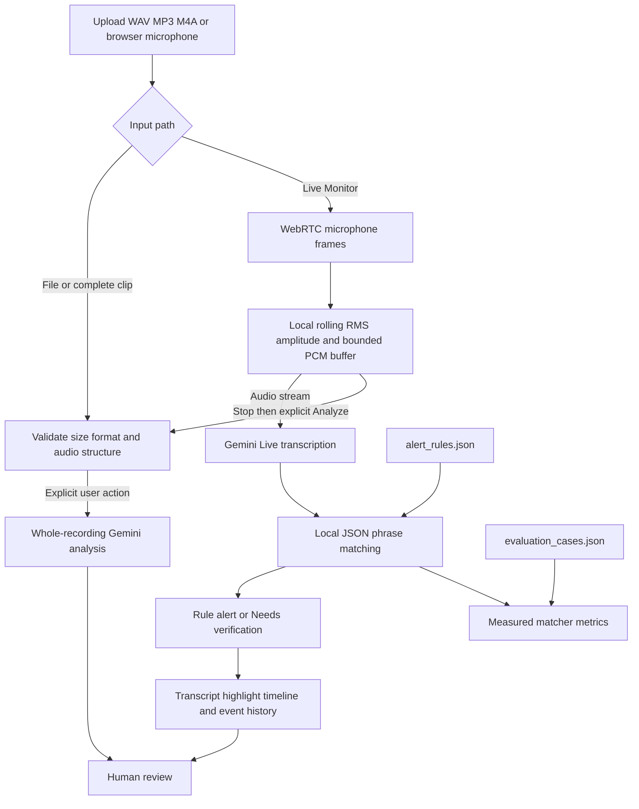

# 🎙️ AURA: Explainable Audio Intelligence System

**AURA** (Audio Understanding & Reasoning Agent) is a human-reviewed audio analysis dashboard powered by Google Gemini. It analyzes complete audio files, applies a separate configurable phrase-rule dataset to timestamped transcripts, and presents evidence-linked results. Phrase reports are not verified real-world events.

**Functional TRL-4 Prototype.**

---

## ⚡ Key Features

- **Multimodal AI Engine:** Powered by **Google Gemini** (configured via `.env`), enabling direct audio-to-text processing.
- **Explicit Model Control:** Model is set via `GEMINI_MODEL` in `.env` — no dynamic model switching.
- **7-Language Support:** English, Hindi, Mandarin, Urdu, Tamil, Spanish, French.
- **Granular Emotion Detection:** Identifies complex emotional states (Panic, Hostile, Joy, Urgent, etc.).
- **Vocal Summaries:** Uses **gTTS** to read the executive summary aloud.
- **Interactive Timeline:** Color-coded Plotly visualization of the conversation flow.
- **Forensic QnA:** "Ask AURA" — chat with your audio using Gemini, with timestamp-aware answers.
- **Configurable phrase rules:** exact English/Hindi variants, negation/context checks, optional fuzzy matching, duplicate handling, and rule-backed explanations.
- **Waveform and event navigation:** browser-decoded amplitude waveform, playback position, and timestamped phrase markers.
- **Live microphone monitor:** WebRTC capture with a rolling RMS chart, incremental Gemini Live transcription, and local phrase matching. Gemini full-recording analysis remains a separate, explicit action after Stop.
- **Review alerts:** actual rule detections create an acknowledgeable, time-limited indicator and session history; uncertain contexts are labeled for verification.
- **Labeled matcher evaluation:** local precision, recall, F1, false-positive/missed-event rates, and measured matcher-only latency.

---

## 🛠️ Tech Stack

| Layer | Technology |
|---|---|
| Frontend | Streamlit |
| AI Core | Google Generative AI (Gemini) |
| Voice | gTTS (Google Text-to-Speech) |
| Visualization | Plotly, browser Web Audio API, WebRTC |
| Data | Pandas |
| Config | python-dotenv |

---

## 🚀 Installation & Setup

### Prerequisites

- Python 3.10+
- A **Google Gemini API Key** — get one free from [Google AI Studio](https://aistudio.google.com/)

### Step 1: Clone or Download

```bash
git clone <repo-url>
cd AURA-Explainable-Audio-Intelligence-System
```

### Step 2: Create a Virtual Environment

**Windows:**
```bash
python -m venv venv
.\venv\Scripts\activate
```

**Mac/Linux:**
```bash
python3 -m venv venv
source venv/bin/activate
```

### Step 3: Install Dependencies

```bash
pip install -r requirements.txt
```

### Step 4: Configure Environment Variables

Create a `.env` file in the project root:

```env
GEMINI_API_KEY=your_actual_api_key_here
GEMINI_MODEL=gemini-3.6-flash
AURA_LIVE_TRANSCRIBE_MODEL=gemini-3.5-transcribe-live
AURA_FUZZY_MATCHING=false
AURA_MAX_AUDIO_MB=50
AURA_ALERT_INTERVAL_SECONDS=15
AURA_PROVIDER_RETRIES=2
```

> ⚠️ **Never commit `.env` to GitHub.** It is already listed in `.gitignore`.
> A safe template is provided in `.env.example`.

Temporary Gemini capacity responses are retried twice by default. Set
`AURA_PROVIDER_RETRIES=0` to disable retries.

---

## ▶️ How to Run

```bash
python -m streamlit run frontend/app.py
```

The application will automatically:
1. Load `GEMINI_API_KEY` and `GEMINI_MODEL` from `.env`
2. Initialize the Gemini engine
3. Show **● Gemini Connected** in the sidebar and header

No API key entry is required in the UI.

For Windows Command Prompt (CMD), use these exact commands:

```cmd
py -3.11 -m venv .venv
.venv\Scripts\python.exe -m pip install -r requirements.txt
copy .env.example .env
notepad .env
.venv\Scripts\python.exe -m streamlit run frontend\app.py
```

Set `GEMINI_API_KEY` in `.env` before starting the app. Keep the CMD window open
while using the dashboard.

For Windows PowerShell, the commands can be run as follows:

```powershell
py -3.11 -m venv .venv
.\.venv\Scripts\Activate.ps1
python -m pip install -r requirements.txt
Copy-Item .env.example .env
notepad .env
python -m streamlit run frontend/app.py
```

Use a supported Python version (3.10 or newer). If PowerShell blocks environment activation, either use `Set-ExecutionPolicy -Scope Process -ExecutionPolicy Bypass` for that terminal or run `.venv\Scripts\python.exe -m pip install -r requirements.txt` and `.venv\Scripts\python.exe -m streamlit run frontend/app.py` directly. `GEMINI_API_KEY` is used only by the backend and is never placed in browser JavaScript.

---

## 🔍 Verify Gemini Connection

To test your API key and model before running the full app:

```bash
python check_models.py
```

Expected output:
```
--- 🔍 Checking Gemini Configuration ---
Configured model: <value of GEMINI_MODEL>
✅ The model configured by `GEMINI_MODEL` is reachable. Response: OK
```

---

## 📂 Project Structure

```
AURA-Explainable-Audio-Intelligence-System/
├── backend/
│   ├── alert_state.py       # Alert acknowledgment and expiration
│   ├── aura_engine.py       # Gemini analysis, validation, existing KnowledgeBase
│   ├── evaluation.py        # Labeled matcher metrics and measured latency
│   ├── knowledge_matcher.py # Dataset validation and deterministic matching
│   ├── live_pipeline.py     # Final transcript processing and local matching
│   └── live_transcription.py # Bounded asynchronous Gemini Live worker
├── frontend/
│   ├── app.py               # Streamlit dashboard, analysis, alerts, history
│   ├── audio_visualization.py # Recording waveform and marker navigation
│   └── live_audio.py        # Bounded real-time PCM capture and amplitude
├── training/
│   ├── alert_rules.json     # Configurable phrase rules and examples
│   └── evaluation_cases.json # Separate labeled evaluation corpus
├── tests/
│   ├── test_alert_state.py
│   ├── test_audio_validation.py
│   ├── test_evaluation.py
│   ├── test_knowledge_matcher.py
│   ├── test_live_audio.py
│   ├── test_live_pipeline.py
│   └── test_live_transcription.py
├── training/
│   └── knowledge_base.json  # Feedback/memory store
├── .env                     # ⚠️ Local only — not committed
├── .env.example             # Safe template to commit
├── .gitignore
├── check_models.py          # Gemini connection test utility
├── requirements.txt
└── README.md
```

---

## Architecture



Audio uploaded for file analysis is sent to the configured Google Gemini API. When Live Monitor is started and microphone permission is granted, audio is streamed to Gemini Live for transcription; local phrase matching and the amplitude graph run separately. The complete buffered recording is sent for whole-recording Gemini analysis only after Stop and the explicit Analyze captured audio action. Temporary analysis files are removed by default. Local browser playback and waveform decoding do not create a spectrogram.

## Audio monitoring and sound events

- **File analysis:** WAV, MP3, and M4A, capped at 50 MB by default. Empty, malformed WAV, unsupported formats, and invalid container signatures are rejected before the provider request.
- **Live microphone:** choose **Live Monitor**, grant browser microphone access, and use **Start Monitoring** / **Stop Monitoring**. `streamlit-webrtc` delivers each incoming audio frame through its background `audio_frame_callback`; AURA records frame count, timestamp, format, RMS amplitude, and callback errors before sending bounded PCM chunks to Gemini Live. The graph independently updates rolling RMS amplitude (not a spectrogram) while Gemini Live provides interim and finalized transcript text. Finalized phrases are matched locally against `training/alert_rules.json`; rule alerts do not establish that a real-world event occurred. Captures are resampled to mono 16 kHz PCM and limited to three minutes in memory. Stop requests are nonblocking; the recording is finalized after WebRTC and transcription shut down. Select **Analyze captured audio** after stopping for optional whole-recording Gemini analysis.
- **Live transcript timing:** the Live API does not provide word-level timestamps here. Displayed positions are approximate capture-stream positions, and measured capture-to-dashboard latency is based on server-side monotonic timestamps; it does not measure browser paint or end-user display latency. Provider and network delays vary, so no fixed live latency is guaranteed.
- **Startup/device errors:** the monitor reports Idle, Processing, Listening, or Error. WebRTC negotiation time is not counted as silence. After WebRTC reports `playing`, if no callback frame arrives for 30 seconds, AURA stops capture and reports a permission/device troubleshooting message rather than claiming that monitoring is active. The live panel shows signaling state, frame count, last frame time, sample format, callback errors, and transcription queue size.
- **Provider failures:** Live transcription uses a 20-second connection timeout and a 10-second audio-send timeout. Errors are surfaced in the monitor; no transcript or alert is invented when the provider fails.
- **Network/permissions:** microphone access requires a secure browser context (localhost is allowed; remote access requires HTTPS). WebRTC may also require STUN/TURN connectivity. A failed connection is reported in the interface; no audio is silently treated as analyzed.
- **TURN relay for mobile/strict networks:** the app always uses Google STUN. Prefer configuring `AURA_TURN_URLS` plus the provider's TURN REST shared secret as `AURA_TURN_EPHEMERAL_SECRET`; AURA then creates an expiring HMAC credential for each app session. `AURA_TURN_CREDENTIAL_TTL` defaults to 3600 seconds. Static `AURA_TURN_USERNAME` and `AURA_TURN_PASSWORD` are disabled by default because WebRTC exposes them to the browser; set `AURA_ALLOW_STATIC_TURN_CREDENTIALS=true` only as a temporary compatibility fallback, and rotate those credentials. Store all values under **Streamlit Cloud → Settings → Secrets** and never commit them.
- **Pause and resume:** in **Live Monitor**, select **Start Monitoring**, grant
  microphone permission, and use **Pause Monitoring** to stop accepting new
  microphone frames without ending the transcription session. Select **Resume
  Monitoring** to continue; **Stop Monitoring** ends the session and finalizes
  the buffered recording.
- **Sound classification:** this repository does not include a dedicated alarm, siren, glass, dog, or background-noise classifier. Gemini may return model-reported important sounds for a complete recording, but these are not independent classifier results. No sound-class labels are fabricated.

## Phrase rules and explanation

Edit `training/alert_rules.json` to configure rule IDs, phrases, variants, language, category, event type, priority, explanations, recommended review actions, evidence requirements, exclusions, ambiguity phrases, and human-verification requirements. Dataset fields, duplicate IDs, priorities, and matching thresholds are validated at startup. The existing `KnowledgeBase` remains a separate feedback store.

Exact matching is enabled by default and respects phrase boundaries. Negation and context checks consider the matched transcript segment and up to three preceding segments. Fuzzy matching is disabled by default; enable it with `AURA_FUZZY_MATCHING=true`. Its similarity score describes text similarity only, not event confidence. Semantic matching is not implemented. Review-only ambiguous mentions (for example a fire scene in a movie) appear as **Needs verification** and do not activate the alert indicator. Configured priorities are review labels, not proof of severity or hazard.

The blink indicator is driven by new non-ambiguous rule detections, stops when acknowledged or after `AURA_ALERT_INTERVAL_SECONDS`, and remains in session history. Rules requiring human verification still require reviewer confirmation. Transcript timestamps and original evidence are shown with the matched JSON record and recommended review action.

Each live rule match is available immediately from local transcript matching and is labeled as transcript evidence, not a verified real-world event. Optional contextual audio analysis is a separate user action after stopping; it never delays or upgrades the initial rule alert to a verified incident.

## Tests and evaluation

From the repository root, run:

```powershell
python -m unittest discover -s tests -v
```

The dashboard evaluation view runs the separate `training/evaluation_cases.json` labeled set and calculates precision, recall, F1, false-positive rate, missed-event rate, and measured matcher latency per case. These metrics describe only this small local rule-matching set; latency excludes Gemini, network, audio capture, and transcription, and the results are not a production guarantee. Add reviewed examples to the evaluation file without using live output as its own ground truth.

The automated suite uses mocked Gemini/WebRTC inputs. It does not substitute for granting browser microphone permission and testing a real device, network, and Gemini API account end to end.

To manually test live transcription, start the app with the CMD commands above,
choose **Live Monitor**, grant microphone permission, and speak a configured
phrase such as “Please help” followed by ordinary speech. Confirm that interim
text changes while speaking, the finalized line appears once with an
approximate timestamp, and the matching explanation is shown without claiming
that an incident occurred. Test **Pause Monitoring**, speak while paused,
resume, and then use **Stop Monitoring**. The browser microphone, network, and
Gemini account must be working for this manual test; the repository's automated
tests only validate the mocked incremental path.

## Demonstration

1. Start the app and choose **Upload File** with an authorized WAV, MP3, or M4A recording, or choose **Live Monitor** and grant microphone access.
2. While monitoring, review the rolling amplitude graph and incremental transcript. Configured phrase matches are rule-based review alerts, not verified incidents.
3. Stop monitoring to finalize the buffered recording. Whole-recording Gemini analysis is optional and requires the separate **Analyze captured audio** action.
4. Review the amplitude waveform and playback, then select timestamped markers and inspect highlighted transcript evidence.
5. Inspect the configured rule record, match type, priority, explanation, review action, and **Needs verification** status where applicable.
6. Acknowledge a triggered alert and review the session history and labeled evaluation metrics.

Do not treat a spoken phrase or model-reported sound as proof of a real-world event. Human verification and independent evidence remain necessary.

---

## 🔮 Future Roadmap

- **Remote deployment hardening** — configurable TURN infrastructure and browser/device integration tests
- **Speaker Identification** — voice fingerprinting
- **PDF Reports** — auto-generated forensic evidence reports

---

**Built with ❤️ — AURA Explainable Audio Intelligence**

---

## AURA audio intelligence workflow

AURA is an AI-assisted audio intelligence system that transforms unstructured audio into structured, explainable, time-aware insights for faster human review. Gemini is the analysis engine; AURA supplies the input workflow, structured incident view, explainability, reviewer controls, and an auditable analysis record.

```text
Audio input
  -> Gemini audio analysis (one structured request)
  -> Transcript + tone + event context
  -> Incident brief + attention priority
  -> Smart timeline + selected-moment explanation
  -> Ask AURA (global or moment mode)
  -> Analysis record + optional audio summary
```

## Structured analysis features

- **AURA Incident Brief** — event, timestamp range, speakers, model-reported sound events, context, observations, confidence, summary, and a human-review reminder.
- **Attention Priority** — LOW, MEDIUM, or HIGH based on model-provided priority and reasons. This is a review aid, not a safety, crime, or risk determination.
- **Smart Event Timeline** — transcript segments are coloured by importance and retain timestamps, speaker labels, tone, urgency, confidence, event context, and model-provided reasons when available.
- **Why was this flagged?** — selecting an important/urgent segment displays only the reasons supplied in the analysis. AURA never invents acoustic or behavioural signals that were not returned by the model.
- **Ask About This Moment** — select a timeline segment to switch Ask AURA into Moment Mode; the question receives the selected segment and only its immediate context. Without a selection, Ask AURA remains in Global Mode for the complete audio.
- **Multilingual understanding** — the selected language guides Gemini, detected languages are displayed only when Gemini returns them, transcripts retain their original language, and AURA provides an English summary plus an optional original-language summary.
- **AURA Analysis Record** — includes an analysis ID, input filename, duration (using WAV metadata when available or the final transcript timestamp otherwise), UTC analysis time, configured model, status, event count, overall priority, and SHA-256 integrity reference.

## Privacy controls

Privacy Mode is available in the sidebar:

- **Remove temporary uploaded audio after analysis** is enabled by default. It deletes AURA's local temporary input file once processing finishes; it does not retract a file already sent to the configured AI provider.
- **Do not retain conversation history** displays the current answer but does not keep chat messages in the Streamlit session.
- **Anonymize speaker labels** replaces displayed speaker labels with `Speaker A`, `Speaker B`, and so on. It does not alter the transcript words.

These controls improve predictable local handling but are not a complete privacy or security guarantee. Do not upload audio you are not authorized to process, and review the applicable provider and organizational policies.

## Human-in-the-loop and limitations

AURA reports model-derived observations and AI assessments to support a reviewer. It does not prove events, identify people, determine criminality, make safety predictions, or establish legal admissibility. Confidence values are model estimates, and the SHA-256 value is an integrity reference only. Audio quality, overlapping voices, unsupported languages, and model limitations can affect transcript and timeline accuracy. Human review is recommended for every important finding.

## Example review flow

1. Choose the likely spoken language and upload an MP3, WAV, or M4A file, or record with the microphone.
2. Optionally configure Privacy Mode, then select **Analyze Audio**.
3. Review the Incident Brief, priority reasons, and important findings.
4. Use the Smart Timeline to select a moment and review its model-provided explanation.
5. Ask a global question or a moment-specific question, then inspect the Analysis Record and integrity hash.
